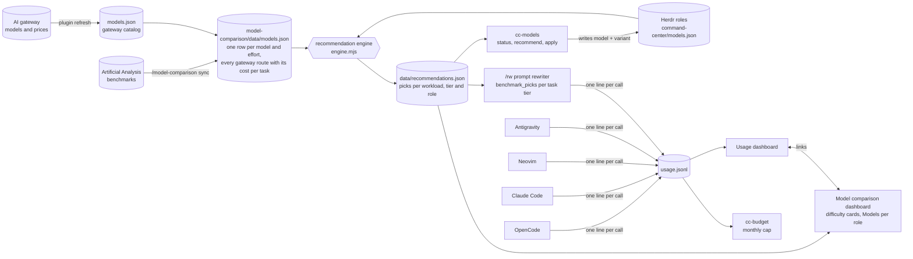

# AI workflow

Three tools that work as one: they log every model call in one place, judge
models with one set of benchmarks, and recommend models with one engine.

| Tool | What it does | Read more |
|---|---|---|
| [`ai-gateway/`](ai-gateway/README.md) | OpenCode plugin for the company AI gateway, the usage log and **usage dashboard** (`/usage-dashboard`), and the **model comparison** (`/model-comparison`) with the **recommendation engine** | [model-comparison](ai-gateway/model-comparison/README.md) |
| [`herdr-commander/`](herdr-commander/README.md) | Herdr Command Center: a Commander that plans, dispatches and reports, workers per role, `cc-models` to choose each role's model | |
| [`opencode-prompt-rewrite/`](opencode-prompt-rewrite/README.md) | `/rw` in OpenCode: improves a prompt and recommends the model and effort to run it with | |

## Install

```sh
ai-workflow/install.sh             # all three, in order; every step asks first
ai-workflow/install.sh --dry-run   # only report what would change
ai-workflow/install.sh --only gateway|rewrite|herdr
```

The gateway step comes first because the other two read what it writes. Then
open `/model-comparison` once (OpenCode or Claude Code): it syncs the benchmarks
and writes the recommendations the other tools read. Each tool still installs on
its own with its own `install.sh` (the rewriter with `node scripts/install.mjs`).

## How it fits together



Everything lives in `$GATEWAY_COST_DIR` (default `~/.gateway-cost/`): the
catalog, the usage log, both dashboards and the recommendations. Nothing from
the gateway or from Artificial Analysis is stored in this repository.

**The two dashboards link to each other.** `/model-comparison` starts a local
server that also serves the usage dashboard under the same private URL
(`<token>/usage/`), so the **Usage ↗** link in the comparison and the **Model
comparison ↗** button in the usage dashboard switch between them. Opened as
files (`~/.gateway-cost/dashboard.html`, `~/.gateway-cost/model-comparison/index.html`)
the links work too, without the sync button.

## Recommendations: one engine for every tool

`ai-gateway/model-comparison/engine.mjs` decides what "the best model" is, for
the dashboard, for `cc-models` and for the prompt rewriter alike:

1. **Score the workload, not just general intelligence.** Agentic coding is 60%
   Terminal-Bench 4.0 + 40% Intelligence Index, tool use 60% AutomationBench +
   40% Intelligence Index, planning 60/40 the other way round, writing 70%
   Intelligence Index + 30% GDP.pdf. Only current Artificial Analysis
   benchmarks are used (retired ones are missing for most current models).
2. **Every route is a candidate**: each provider and model id at each effort it
   offers, priced at its own cost per task (Artificial Analysis' token counts at
   the gateway price, so a verbose model or a high effort is not flattered by a
   low token price). Superseded releases are never recommended. A $0 price counts
   as $0.005 per task.
3. **Good enough first**: a pick must reach a share of the best score that is
   available (light 45-65%, standard 75-90%, hard 85-96%, frontier 90-99%,
   from lean to max). Relative, so it does not go stale when the index is re-based.
4. **Then cheap**: every doubling of cost must buy enough extra score (light 8-16
   points of the best score, standard 4-9, hard 1.5-5, frontier 0.5-2). Speed
   counts for latency-bound roles (Commander, explore).

Herdr roles map to a workload and a tier (implementer: coding/standard,
architect: planning/hard, Commander: tool use/light, ...), overridable per role
with `"recommend": {"workload": ..., "tier": ...}` in `models.json`. The prompt
rewriter maps its task tiers (quick, standard, complex, deep reasoning) to the
engine's tiers and passes the engine's pick per tier to the rewrite model.

```sh
node ~/.config/opencode/plugins/ai-gateway/model-comparison/recommend.mjs roles    # picks per Herdr role
node ~/.config/opencode/plugins/ai-gateway/model-comparison/recommend.mjs tiers    # picks per workload and tier
cc-models recommend --profile balanced                                              # the same, with the reasons
```
