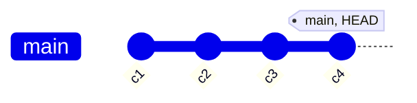
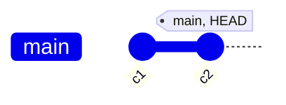
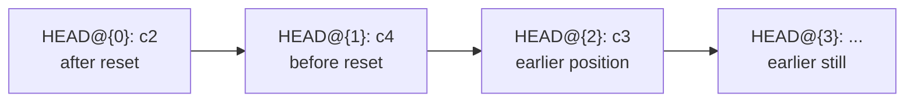

# Git

Notes on git, from the everyday commands to the ones that rewrite history. Each topic has diagrams that show what happens to the commits.

## Contents

**Reading the history**

- [HEAD notation](#head-notation-headn-vs-headn): the difference between `HEAD~n` and `HEAD@{n}`

**Recovering and undoing**

- [Reflog](reflog.md): the safety net that records every move
- [Undoing things](undo.md): reset, revert, and restore

**Changing history**

- [Cherry-pick](cherry-pick.md): copy one commit onto another branch
- [Rebase](rebase.md): move a branch onto a new base, and interactive rebase
- [Squash](squash.md): combine several commits into one
- [Fixup](fixup.md): fold a small fix into an older commit, and how it compares to amend
- [Changing a commit message](reword.md): amend and reword for commits that are not pushed

**Working with remotes and state**

- [Remotes and syncing](remotes.md): fetch, pull, push, and diverged branches
- [Stash](stash.md): park uncommitted work
- [Worktree](worktree.md): check out several branches at once in separate folders

**Finding problems**

- [Bisect](bisect.md): find the commit that introduced a bug

## HEAD notation: `HEAD~n` vs `HEAD@{n}`

Both forms count backwards from `HEAD`, but they count different things.

| Notation | Counts | Depends on |
|---|---|---|
| `HEAD~n` | parent commits in the history graph | the commit structure, always the same |
| `HEAD@{n}` | previous positions of `HEAD` in the [reflog](reflog.md) | what was done, in order |

`HEAD~n` answers "which commit is n steps back in the history?". `HEAD@{n}` answers "where was `HEAD` n moves ago?".

### Example

Four commits on `main`: `c1` ← `c2` ← `c3` ← `c4`. `HEAD` is on `c4`. Then this runs:

```bash
git reset --hard HEAD~2
```

`HEAD` moves to `c2`. `c3` and `c4` are no longer on `main`, but they still exist.

Before the reset, `main` points to `c4`:



After the reset, `main` points to `c2`. `c3` and `c4` are no longer on `main`, so the graph only reaches `c2`. They still exist and can be found through the reflog:



Now the two notations give different answers:

| Expression | Commit | Why |
|---|---|---|
| `HEAD` | `c2` | current position |
| `HEAD~1` | `c1` | parent of `c2` in the graph |
| `HEAD@{1}` | `c4` | the position before the reset |
| `HEAD@{2}` | `c3` | two moves ago in the reflog |

`HEAD~1` moved backwards along the graph. `HEAD@{1}` went back to where `HEAD` was before the last action.



The reflog is a timeline of actions. The commit graph is the structure of the history.

### When to use which

- `HEAD~n` when a commit is described by its position in history: `git show HEAD~2`, `git rebase -i HEAD~3`.
- `HEAD@{n}` when going back to an earlier position: `git reset --hard HEAD@{1}` after a mistake.

### Merge commits

A merge commit has two parents. `HEAD~1` follows the first parent, which is the branch that was checked out during the merge. The second parent is written with `^`:

```bash
git show HEAD^2                  # the second parent of a merge commit
git show HEAD~1^2                # the second parent of the commit before HEAD
```

`^` picks a parent, `~` counts first-parent steps. For a normal commit with one parent, `HEAD^` and `HEAD~1` are the same.

## Practice safely

Most of these commands rewrite history, so the examples are practiced in a throwaway repo, not in a real project:

```bash
mkdir /tmp/git-lab && cd /tmp/git-lab
git init -b main
for i in 1 2 3 4; do echo "line $i" >> notes.txt && git add notes.txt && git commit -qm "commit $i"; done
git log --oneline --graph
```

The repo now has four commits that can be broken, fixed, and recovered.
