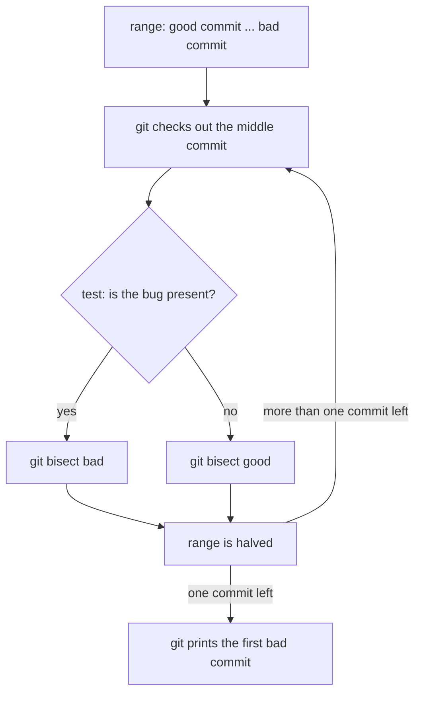
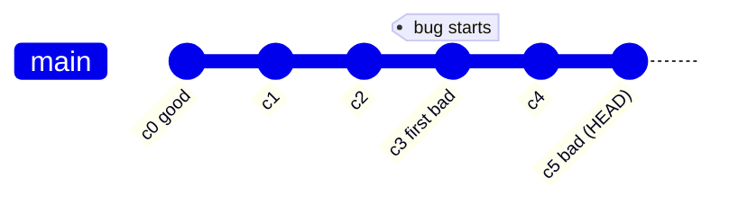

# Bisect

Git does not know what the bug is. It only knows the history and the answers you give. Bisect is a binary search: you name one commit where the bug is present (bad) and one where it is absent (good), and git checks the commit in the middle. You decide whether that commit is good or bad, and git halves the range again.

The bug is defined by a question with a yes or no answer, such as "does the login page crash?" or "does `notes.txt` contain `line 3`?". That question is the test.



With 16 commits between good and bad, four answers are enough (2 × 2 × 2 × 2 = 16). With 1000 commits, about 10 answers are needed.

## Manual run

```bash
git bisect start
git bisect bad                   # the current commit has the bug
git bisect good v1.2             # an older commit without the bug (a tag or hash)
```

Git checks out a commit in the middle. The test is run by hand, then the answer is given:

```bash
git bisect good                  # the bug is not in this commit
git bisect bad                   # the bug is in this commit
```

When one commit is left, git prints it as the first bad commit:

```bash
git bisect reset                 # returns to the branch the search started from
```

## Automatic run

`git bisect run` runs a script for each commit. The exit code of the script is the answer:

| Exit code | Meaning |
|---|---|
| `0` | good, the bug is not present |
| `1` to `127`, except `125` | bad, the bug is present |
| `125` | skip, this commit cannot be tested |

So the script must exit with an answer, not just print one. For a bug that shows up in a test suite, the test command is enough. For a bug that is only visible by hand, a script is written:

```bash
#!/bin/sh
# exits 1 when "line 3" is in notes.txt, which is the bug here
! grep -q "line 3" notes.txt
```

```bash
git bisect start HEAD <good-hash>   # first is bad, second is good
git bisect run ./check.sh
git bisect reset
```

## Diagram of a search



Git picks a commit between the good and bad ends, here `c2` or `c3`, depending on the range. Each answer removes half of the remaining range. In this example, `c2` is good and `c3` is bad, so `c3` is the first bad commit.

## Try it

In the practice repo, find the commit that introduced `line 3`:

```bash
git bisect start
git bisect bad HEAD
git bisect good HEAD~3          # commit 1 has no "line 3"
git bisect run sh -c '! grep -q "line 3" notes.txt'
git bisect reset
```
