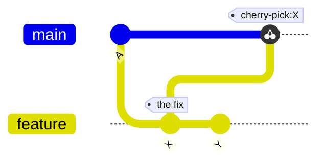
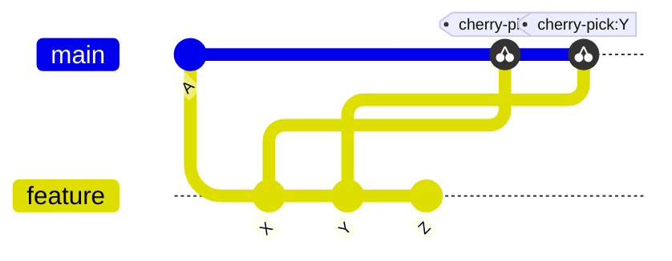

# Cherry-Pick

`git cherry-pick <commit>` applies the changes of one commit to the current branch. The result is a new commit with the same changes and a new hash. The original commit is not changed.

Cherry-pick does not rewrite old history. It only adds a commit on top of the current branch.



After the cherry-pick, `main` has a copy of `X`. The copy has a different hash. `feature` keeps `X` and `Y` unchanged.

## Use cases

- A fix is committed on the wrong branch and must also be on `main`.
- One commit from a feature branch is needed without the rest of the branch.
- A hotfix on a release branch must also be applied to `main`.

## Multiple commits

```bash
git cherry-pick X Y              # applied in the order given
git cherry-pick A..B             # every commit after A, up to and including B
```



## Undo a cherry-pick

A cherry-pick adds one commit, so the undo depends on whether the commit is pushed.

```bash
git reset --hard HEAD~1          # local only, and nothing else was committed after it
git revert <new-hash>            # pushed branch, the history keeps the undo
```

## Conflicts

A conflict stops the cherry-pick until it is resolved:

```bash
git status                       # shows the conflicting files
git add <file>                   # after the conflict is fixed in the file
git cherry-pick --continue       # finishes the cherry-pick
git cherry-pick --abort          # cancels it and restores the branch
```

## Try it

In the practice repo:

```bash
git switch -c side HEAD~2
echo "extra" > extra.txt && git add extra.txt && git commit -qm "side work"
git switch main
git cherry-pick side             # "side work" is added to main as a new commit
git log --oneline --graph --all
```
