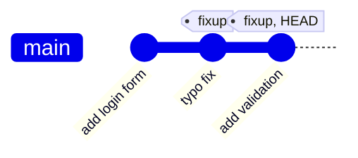
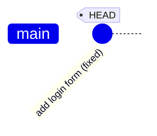
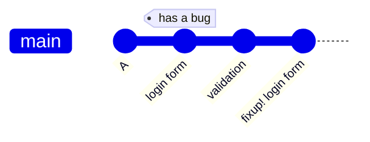
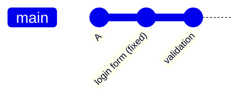
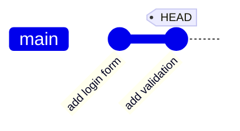
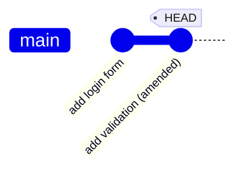

# Fixup

Fixup is a squash that drops the message of the small commit. It is used when a commit only contains a correction of an earlier commit, and its message would not be useful in the history.

```bash
git rebase -i HEAD~3
```

```
pick 1a2b3c4 add login form
fixup 5d6e7f8 typo fix
fixup 9f8e7d6 add validation
```

## What happens

Before:



After:



The changes of `typo fix` and `add validation` are merged into `add login form`. The message of `add login form` is the only one kept.

## Fixup an older commit

Instead of editing the list by hand, a fixup commit is created first:

```bash
git add <file>
git commit --fixup 1a2b3c4       # creates a commit titled "fixup! add login form"
git rebase -i --autosquash HEAD~3
```

`--autosquash` moves the fixup commit below its target and sets its keyword to `fixup`. The editor opens with the list already arranged, so only the save and close steps are left.



After `--autosquash` runs, the fixup is combined into the commit it targets:



## Amend: fix the last commit

`git commit --amend` replaces the last commit with a new one. The new commit contains the staged changes and gets a new hash. No rebase is needed, and the message can be changed in the same step.

Before:



Staged changes are added to `HEAD`:

```bash
git add <file>
git commit --amend --no-edit     # adds the staged changes, keeps the message
git commit --amend -m "new"      # adds the staged changes and sets a new message
```

After:



The old `add validation` is no longer on the branch. It stays in the reflog, see [reflog](reflog.md).

## Fixup and amend compared

Amend and fixup are the same kind of change. Amend works on `HEAD` in one step. Fixup works on any earlier commit, and needs a rebase to move the change into place.

| | `commit --amend` | `commit --fixup` + rebase |
|---|---|---|
| target | only the last commit | any earlier commit |
| steps | one command | commit, then `rebase -i --autosquash` |
| message | can be changed | the target's message is kept |
| history | `HEAD` is replaced | every commit from the target to `HEAD` is rewritten |

`commit --amend` is the same as a fixup of `HEAD`, with the rebase skipped.

Amend changes the hash of a commit, so a pushed commit leaves the branch [diverged](remotes.md) after amending it.

## Choosing between squash, fixup, and amend

| Situation | Command |
|---|---|
| the last commit needs a correction | `commit --amend` |
| an earlier commit needs a correction | `commit --fixup`, then `rebase -i --autosquash` |
| both messages describe useful work | `squash` |
| the small commit only corrects the earlier one | `fixup` |
| the small commit's message should be used instead | `squash`, then edit the message |

## Undo a fixup

A fixup is part of a rebase, so the undo is the same:

```bash
git reset --hard ORIG_HEAD       # right after the rebase finishes
```

See [reflog](reflog.md) for other positions.

## Try it

In the practice repo, fix the first commit from the last one:

```bash
echo "fix" >> notes.txt && git add notes.txt
git commit --fixup HEAD~3        # the target is the first commit
git rebase -i --autosquash --root   # --root includes the first commit
git log --oneline                # the fix is part of the first commit
```
