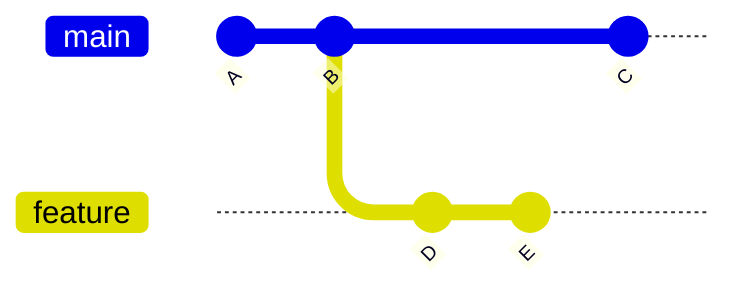
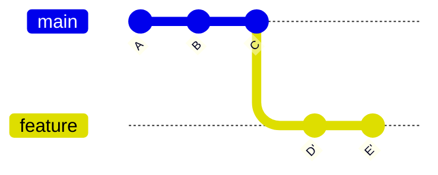
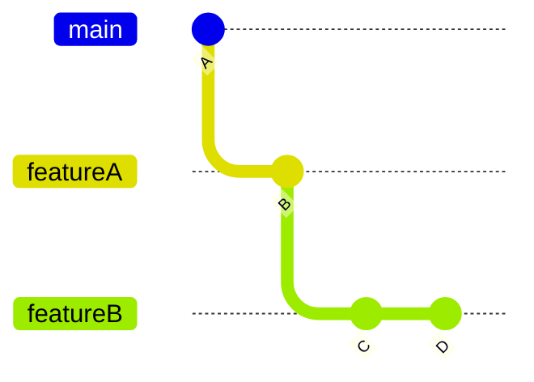
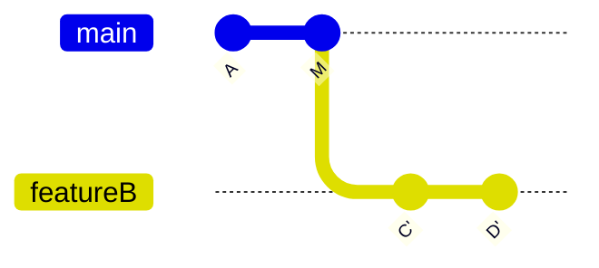
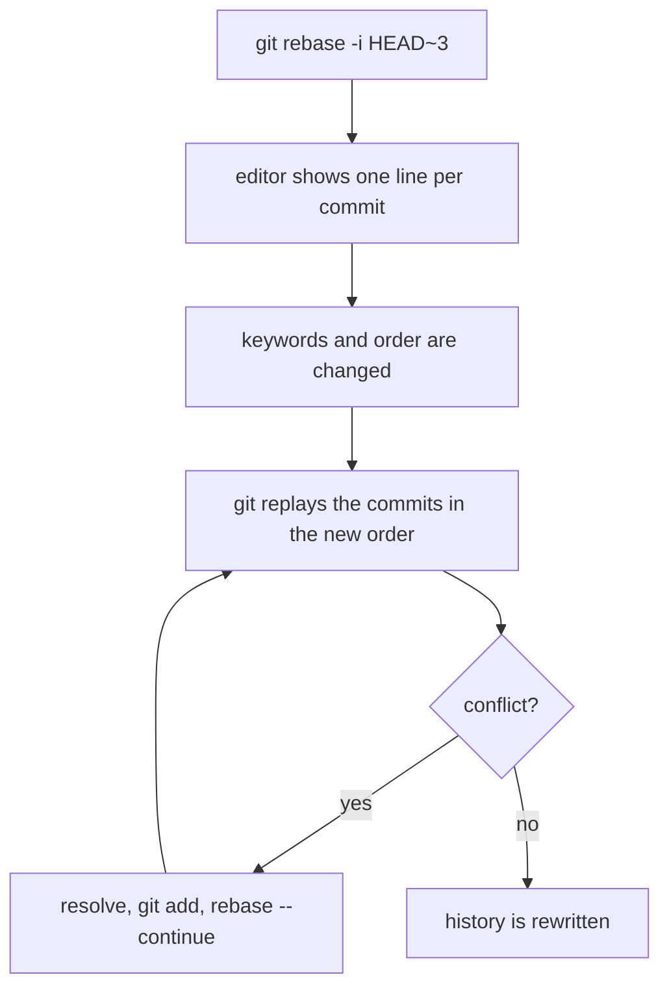

# Rebase

Rebase copies commits onto a new base. Each copy is a new commit with a new hash, so rebase rewrites history. It is used on branches that are not shared. Squash and fixup are both done with interactive rebase, see [squash](squash.md) and [fixup](fixup.md).

## Plain rebase

`git rebase <base>` moves the current branch onto `<base>`. Its commits are replayed one by one on top of the base.



```bash
git switch feature
git rebase main
```



`D'` and `E'` contain the same changes as `D` and `E`, with new hashes. The old `D` and `E` remain in the reflog until they expire.

## Rebase onto a different base

`git rebase --onto <newbase> <oldbase> <branch>` moves only the commits after `<oldbase>`. This is useful when a branch was started on top of another feature branch.



```bash
git rebase --onto main featureA featureB
```



Only `C` and `D` are copied. `B` belongs to `featureA`, so it is not included.

## Interactive rebase

`git rebase -i <base>` opens an editor with one line per commit. The keyword at the start of each line decides what happens to the commit.

```bash
git rebase -i HEAD~3
```

```
pick 1a2b3c4 add login form
pick 5d6e7f8 typo fix
pick 9f8e7d6 add validation
```

| Keyword | Effect |
|---|---|
| `pick` | the commit is kept as it is |
| `reword` | the changes are kept, the message is edited |
| `edit` | the rebase stops at the commit, so it can be changed |
| `squash` | the commit is merged into the one above, both messages are kept |
| `fixup` | the commit is merged into the one above, its message is dropped |
| `drop` | the commit is removed |

Reordering is done by moving the lines. Git replays the commits in the new order.



## Conflicts during a rebase

A conflict stops the rebase at the commit that caused it:

```bash
git status                       # shows the conflicting files
git add <file>                   # after the conflict is fixed in the file
git rebase --continue            # moves on to the next commit
git rebase --skip                # drops the current commit
git rebase --abort               # cancels the rebase and restores the branch
```

## Undo a rebase

Git saves the old tip as `ORIG_HEAD` when a rebase finishes, so the rebase can be undone directly:

```bash
git reset --hard ORIG_HEAD
```

If that is no longer the right point, [reflog](reflog.md) lists every earlier position.

## Try it

In the practice repo:

```bash
git rebase -i HEAD~3             # change the keyword of the second and third line
git log --oneline                # three commits are now one
git reflog                       # the old commits are still listed
```
