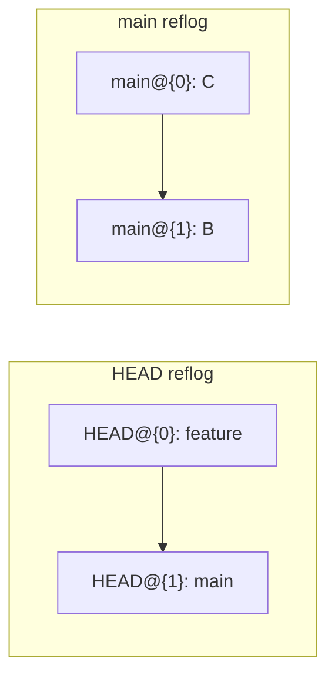

# Reflog

The reflog is a local log of every position `HEAD` has had. Each commit, reset, checkout, rebase, and pull adds an entry. It is never pushed, so it exists only on the machine where the action ran.

It is the first place to look when a commit seems gone. Commits removed from a branch by `reset`, `rebase`, or `commit --amend` are still listed here.

```bash
git reflog
```

```
6ed3beb HEAD@{0}: commit (amend): update config
8cad4c1 HEAD@{1}: commit (amend): update config
b9eecd0 HEAD@{2}: commit: update config
```

The `HEAD@{n}` labels are explained in [HEAD notation](README.md#head-notation-headn-vs-headn).

## Where the reflog stops

The reflog records `HEAD`, and each branch has its own reflog too. `main@{1}` is the previous position of the `main` branch, while `HEAD@{1}` is the previous position of `HEAD`. They differ after a checkout to another branch.



## Time-based lookups

The reflog also accepts times:

```bash
git show HEAD@{2.hours.ago}
git show HEAD@{yesterday}
git show main@{1}                # the previous position of main
```

## Recover a commit

Make a branch at the lost commit first, so it stays reachable after the next move:

```bash
git branch recover 8cad4c1
git log --oneline recover        # check that this is the right state
git reset --hard recover         # only once it is confirmed
```

## Special references

Some operations save their starting point in a separate reference:

| Reference | Set by | Points to |
|---|---|---|
| `ORIG_HEAD` | `reset`, `merge`, `rebase` | the tip before that operation |
| `FETCH_HEAD` | `fetch`, `pull` | the commits fetched most recently |
| `MERGE_HEAD` | a merge that is not finished | the commit being merged in |

`ORIG_HEAD` is the quickest way back after a rebase:

```bash
git reset --hard ORIG_HEAD
```

## How long entries are kept

Reachable entries are kept for 90 days by default (`gc.reflogExpire`). Entries that no branch points to are kept for 30 days (`gc.reflogExpireUnreachable`). After that, `git gc` may delete them.

## Try it

In the practice repo:

```bash
git reset --hard HEAD~2          # two commits leave the log
git log --oneline                # they are not listed here
git reflog                       # they are still listed here
git reset --hard HEAD@{1}        # back to the position before the reset
git log --oneline                # all four commits are back
```
