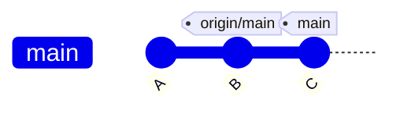
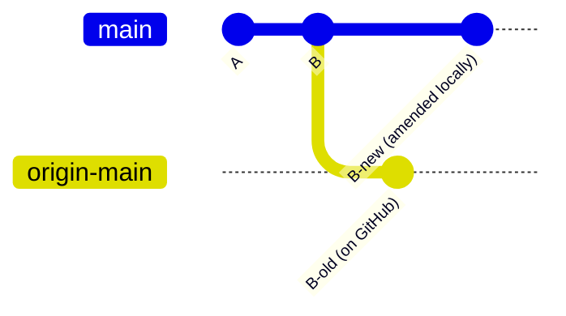
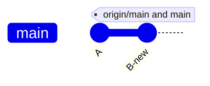
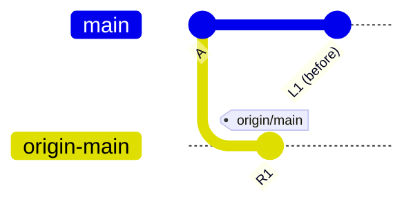
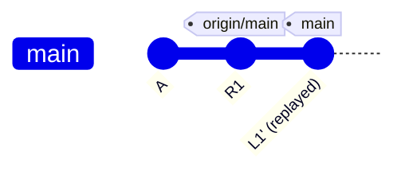

# Remotes and Syncing

`origin` is a second copy of the repository, usually on GitHub. Four commands move commits between the local copy and the remote copy.

| Command | What it does |
|---|---|
| `git fetch` | downloads new commits and updates the remote-tracking branches, such as `origin/main`. Local branches and files stay the same. |
| `git pull` | fetches, then merges `origin/<branch>` into the local branch |
| `git pull --rebase` | fetches, then replays the local commits on top of `origin/<branch>` |
| `git push` | uploads local commits and moves the remote branch to match |

A fetch is always safe, so it is the first step when the state is unclear.

```bash
git fetch
git log --oneline --graph --all
```

## Remote-tracking branches

`origin/main` is a local record of where `main` was on the remote at the last fetch. It is updated by `fetch` and `push`, never by normal commits.



Here `main` has `C` and `origin/main` has `B`. The local branch is one commit ahead.

## Diverged branches

Git reports `diverged` when both sides have commits the other does not have. This happens when a commit that was already pushed is rewritten, for example by `commit --amend` or a rebase. The rewritten commit gets a new hash.



Neither side is wrong. Both versions have the same parent, but they are different commits.

## Fixing a diverged branch

**When the local version is the correct one**, the remote is overwritten with it:

```bash
git push --force-with-lease origin main
```



`--force-with-lease` overwrites the remote only if it still points to the commit that was fetched last. If someone else pushed in the meantime, the push is refused. Plain `--force` overwrites without this check, so it is not used.

**When the remote has commits that are needed**, the local commits are replayed on top of them:

```bash
git pull --rebase
git push
```



After `git pull --rebase`, the local commit is replayed on top of the remote commit:



If the rebase conflicts, the conflicts are resolved, then `git rebase --continue` runs, or `git rebase --abort` cancels it. See [rebase](rebase.md).

## Rules

- History is rewritten (amend, rebase, reset) only on branches that nobody else uses.
- `--force-with-lease` is used instead of `--force`.
- A force push to a shared branch is announced to the people who work on it.
- A pushed commit that must be undone is reverted, see [undo](undo.md).
