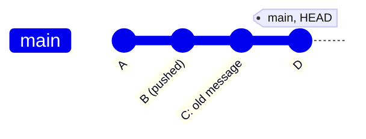
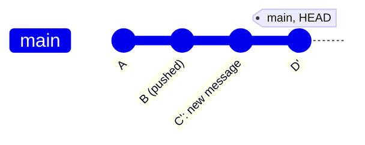

# Changing a commit message

A commit message is part of the commit's hash, so changing it creates a new commit with a new hash. This rewrites history, so it is only done for commits that are **not pushed yet**. `git status -sb` shows how many local commits are ahead of the remote (`ahead 2`).

| Which commit | Command |
|---|---|
| the last one | `git commit --amend` |
| an older one | `git rebase -i` and `reword` |
| several at once | `git rebase -i` with `reword` on each |

## The last commit

```bash
git commit --amend                 # opens the editor with the old message
git commit --amend -m "new message"
```

Without staged changes only the message changes. Staged changes are added to the commit as well, see [fixup](fixup.md).

## An older commit

Before, with `C` and `D` still local:



```bash
git rebase -i HEAD~2               # the last two commits
```

The editor lists the commits oldest first. Change `pick` to `reword` (or `r`) for the one to rename, save, and the editor opens again for the new message:

```text
reword 1a2b3c4 old message
pick   5d6e7f8 D
```



`C'` and `D'` have new hashes. `D` changes too, because its parent changed, even though only the message of `C` was edited. More on this in [rebase](rebase.md).

## Without an editor

`exec` lines in the todo list run a command after a commit is replayed, so messages can be set from a script or a one-liner:

```text
pick 1a2b3c4 old message
exec git commit --amend -m "new message"
pick 5d6e7f8 D
exec git commit --amend -m "new message for D"
```

`GIT_SEQUENCE_EDITOR=<script>` supplies the todo list without opening the editor.

## Already pushed?

After the rewrite the local branch and the remote have different commits and the branch is [diverged](remotes.md). Only force-push when nobody else uses the branch, and use the safe form:

```bash
git push --force-with-lease        # refuses if the remote has commits you haven't seen
```

If a shared branch has the wrong message, leave it. A new commit is cheaper than rewriting what others already have.

## Undo a rewrite

The old commits stay in the [reflog](reflog.md):

```bash
git reflog                         # find the hash before the rebase
git reset --hard HEAD@{n}
```

## Try it

In the practice repo from the [README](README.md#practice-safely):

```bash
git commit --amend -m "commit 4, reworded"   # last commit
git rebase -i HEAD~3                         # reword "commit 2"
git log --oneline                            # new hashes from commit 2 on
```
