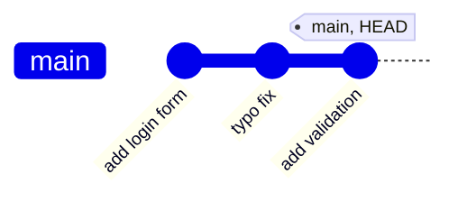
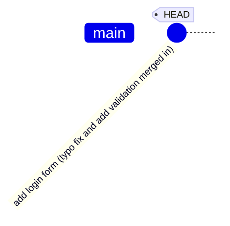
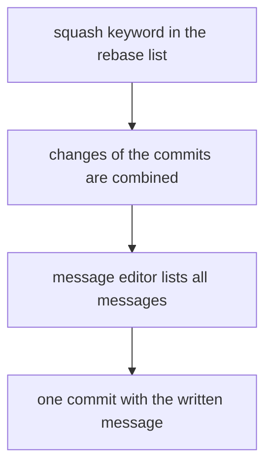
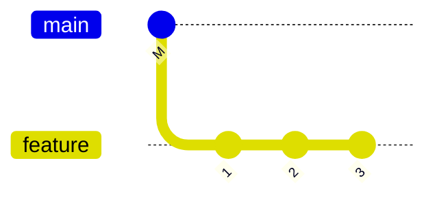
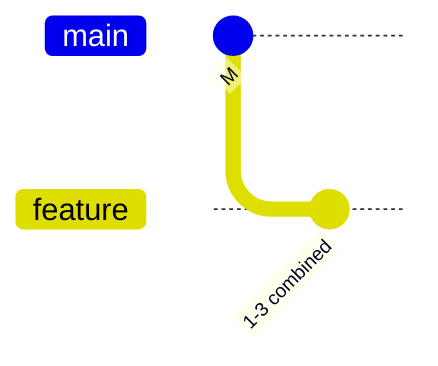

# Squash

Squash combines several commits into one. It is done in an interactive rebase, by setting the keyword of a commit to `squash`. The commit is merged into the commit directly above it.

```bash
git rebase -i HEAD~3
```

```
pick 1a2b3c4 add login form
squash 5d6e7f8 typo fix
squash 9f8e7d6 add validation
```

## What happens

Before:



After:



The three commits become one. Its changes are the sum of the three, and its hash is new. Git opens a message editor, where the messages of all three commits are listed. The final message is written here.

## Squash a rebase result

The commit message editor can be changed in the same step:



## Squash to the start of a branch

To combine all commits of a branch into one, the base is set to the commit before the first one:

```bash
git rebase -i main               # every commit since main is listed
```

Set the first line to `pick`, every other line to `squash`. The result is one commit on top of `main`.



After the squash:



## Squash while committing

`git commit --squash <commit>` creates a commit marked `squash!`. It is combined automatically when the rebase runs with `--autosquash`.

```bash
git commit --squash 1a2b3c4
git rebase -i --autosquash HEAD~3
```

Squash and [fixup](fixup.md) use the same mechanism. Fixup is used when the second message is not needed.

## Undo a squash

Squash is part of a rebase, so the undo is the same as for a rebase:

```bash
git reset --hard ORIG_HEAD       # right after the rebase finishes
```

See [reflog](reflog.md) for other positions.

## Try it

In the practice repo, squash the last three commits:

```bash
git rebase -i HEAD~3             # set the second and third line to squash
git log --oneline                # one commit with the combined message
```
