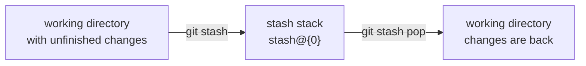
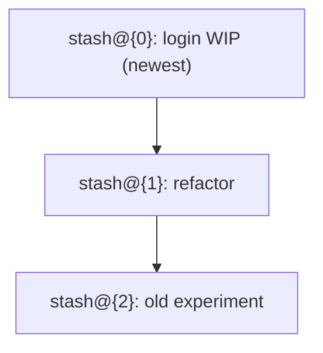

# Stash

Stash saves uncommitted changes to a stack, and clears the working directory. It is used when a branch must be switched without committing unfinished work.



## Commands

```bash
git stash                        # saves tracked changes and cleans the working directory
git stash push -m "login WIP"    # saves with a description
git stash -u                     # also saves untracked files
git stash list                   # shows all stashes
git stash show -p stash@{1}      # shows the changes of one stash
git stash pop                    # applies the newest stash and removes it
git stash apply stash@{1}        # applies a stash and keeps it in the list
git stash drop stash@{1}         # removes one stash
git stash branch new-name        # creates a branch from the stash and applies it there
```

## The stack

Each stash gets an index, the newest is `stash@{0}`. Older ones have higher numbers.



`pop` takes the top entry, `apply` takes any entry and keeps it.

## Conflicts

If the working directory changed in the same place as the stash, `apply` or `pop` stops with a conflict. The conflict is resolved like a merge conflict, then:

```bash
git add <file>
git stash drop                   # only after the changes are safely applied
```

`pop` removes the stash only when it applies cleanly. After a conflict, the entry is still in the list.

## Stash is not a backup

Stashes are local and not pushed unless they are explicitly exported. They are also easy to lose with `stash drop`. Work that must be kept is committed to a branch, even if the commit is temporary.

## Try it

In the practice repo:

```bash
echo "unfinished" >> notes.txt
git stash push -m "unfinished line"
git status                       # the working directory is clean
git stash list
git stash pop                    # the line is back
```
