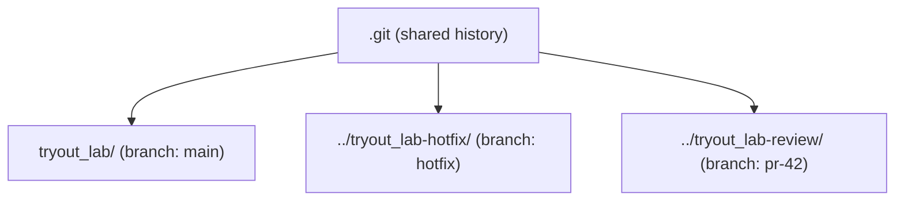

# Worktree

A worktree is an extra folder that is linked to the same repository. Each worktree has its own checked-out branch and its own working files, but they share one `.git` history.



Git does not allow the same branch to be checked out in two worktrees at once. Each branch appears in only one folder.

## Commands

```bash
git worktree add ../hotfix hotfix          # creates ../hotfix with the branch hotfix
git worktree add -b fix-login ../fix main  # creates a new branch fix-login from main
git worktree list                          # shows each folder and its branch
git worktree remove ../hotfix              # removes the folder, the branch stays
git worktree prune                         # cleans up entries for deleted folders
```

## When it is used

- A fix must be made while work on a feature is in progress, without stashing it.
- A pull request is checked out in its own folder, so the running project is not changed.
- A long build or test run must keep going in one branch while another is edited.

## Compared with stash and switch

| Approach | Working files | Work in progress |
|---|---|---|
| `git switch` | one folder, changes must be stashed or committed | kept, but must be moved away |
| `git stash` | one folder, changes are saved to the stack | stored in the stash list |
| `git worktree add` | one folder per branch | stays untouched in its own folder |

## Try it

In the practice repo:

```bash
git worktree add ../git-lab-side -b side-work HEAD~2
git worktree list                # both folders are listed
ls ../git-lab-side               # the files of the older commit
git worktree remove ../git-lab-side
```
