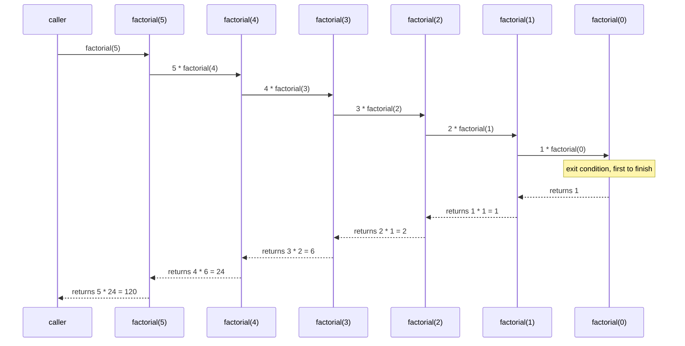

# Recursion

Recursion means **a function calls itself**. Each call pauses until the inner call returns, and the results then unwind back up.

Code in [recursion.go](recursion.go). Run all demos with `go run .` from the [Functions folder](../) — [main.go](../main.go) calls each demo in turn.

## The classic example: factorial

The factorial of 5 is `5 * 4 * 3 * 2 * 1 = 120`. Two implementations:

**With a loop** — nothing new, shown for comparison:

```go
func factorialLoop(number int) int {
	result := 1
	for i := 1; i <= number; i++ {
		result = result * i
	}
	return result
}
```

**With recursion** — the function multiplies its input by the result of calling itself with the input minus one:

```go
func factorial(number int) int {
	if number == 0 {
		return 1
	}
	return number * factorial(number-1)
}
```

## The exit condition is mandatory

Every recursive function needs an `if` that returns **without calling itself** — here `number == 0` returns the hard-coded `1`. Without it, the function keeps calling itself with ever-smaller numbers into the negative range: an infinite call chain that crashes the application.

`1` (not `0`) is the correct exit value: multiplying by `0` would zero out the whole result.

## How it executes

`factorial(5)` does not compute anything before its inner call finishes. The calls stack up first, then resolve bottom-up:



Five executions of the same function run at once (four of them paused, waiting), and each finishing execution hands its value back to the one that started it.

## When to use it

For the factorial, the loop is equally fine — recursion is barely shorter here. But some problems (tree traversal, nested data, divide-and-conquer) are hard or clumsy to express with loops and very natural with recursion. It is a tool to recognize, not one to force everywhere.

## Next

- [Variadic functions](../variadic/README.md) — functions that accept any number of arguments.
