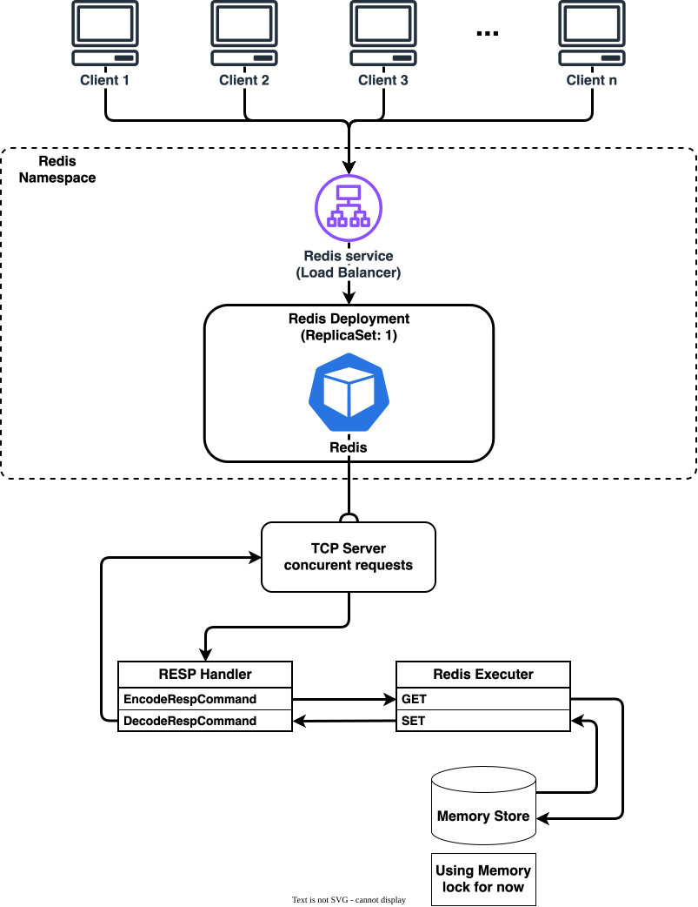
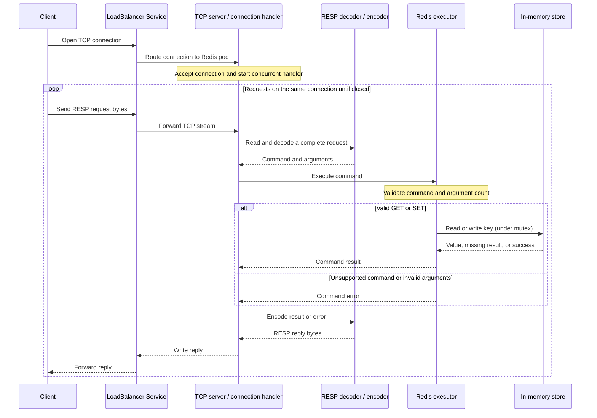

# Architecture

## Overview



The architecture has two parts: Kubernetes exposes and runs one Redis server pod; inside that pod, the Go server handles TCP connections, RESP messages, commands, and the in-memory data store.

## Kubernetes deployment

Clients connect from the laptop to the Redis Service, configured as a LoadBalancer, in the Redis namespace. The Service provides the stable endpoint and routes TCP connections to the Redis pod. A Deployment maintains one replica through its ReplicaSet. The pod contains the Redis container, which runs the Go server process.

The Deployment starts with one replica because the data store is process memory. With one pod, all connections routed by the Service reach the same store. Increasing the replica count would create separate stores in each pod; the Service balances connections but does not synchronize data. Replacing or restarting the pod loses the in-memory data.

## Request lifecycle



1. A client opens a TCP connection to the LoadBalancer Service. The Service routes that connection to the Redis pod.
2. The TCP server accepts the connection and handles it concurrently with other client connections.
3. The connection handler reads the TCP byte stream and passes request data to the RESP handler. Because TCP has no message boundaries, the handler must read complete RESP requests rather than assume each network read is one request.
4. The RESP decoder parses the supported request representation into a command and its arguments. Initially, the supported commands are `GET key` and `SET key value`.
5. The Redis executor validates the command and argument count, then applies the operation to the in-memory store.
6. The RESP encoder formats the result as a protocol reply. The connection handler writes that reply to the client; the connection can then carry another request until it is closed.

## Go modules and responsibilities

The intended package layout is:

```text
main.go          wires the server, command executor, and store together
server/          TCP listener and per-connection lifecycle
resp/            RESP request decoder and reply encoder
command/         GET/SET command execution
store/           shared in-process key/value map
```

`main.go` is the composition point: it creates the store, gives it to the command executor, and gives the executor to the TCP server through a small handler interface. The server should not need to know how commands or values are stored.

### TCP server (`server`)

Owns the network listener and connection lifecycle. It accepts connections, starts a concurrent handler for each connection, reads request bytes, delegates protocol work, writes replies, and closes connections. It does not interpret Redis command semantics or own key/value behavior.


### RESP handler (`resp`)

Owns wire-format concerns: decoding supported RESP requests and encoding RESP replies. The decoder turns protocol data into command arguments; the encoder produces simple-string success, bulk-string values, null values for missing keys, and errors. Keeping this separate allows command execution to work with Go values rather than protocol bytes.

### Redis executor (`redis` / command layer)

Owns command semantics for the supported subset. It dispatches `GET` and `SET`, validates argument counts, and calls the store. `SET` creates or replaces a value; `GET` returns the value or a distinct missing result. Unsupported commands and invalid arguments become errors for the RESP layer to encode.

### In-memory store (`store` / data layer)

Owns the key/value map. It is shared by all connection handlers in one server process. A mutex protects concurrent reads and writes; the lock should be held only while accessing the map, not while doing network I/O or encoding replies. The store is intentionally in-memory for this stage: it has no persistence and is not shared between pods.

## Concurrency and data ownership

Concurrency exists at two levels. The TCP server handles multiple client connections concurrently. Those handlers share the same in-process store, so the store synchronizes access with a mutex. Kubernetes pod replicas do not share that mutex or memory: each pod owns an independent process and store. The initial Deployment therefore remains at one replica. Shared data across replicas would require a separate design, such as a shared data service or explicit replication; it is not provided by the LoadBalancer Service.

## Scope

The target server supports RESP requests for string `GET` and `SET` operations, concurrent client connections, one shared in-process store, and a LoadBalancer Service routing to a single pod. Persistence, additional Redis commands/data types, authentication, TLS, replication, and clustering are outside this architecture's initial scope.
