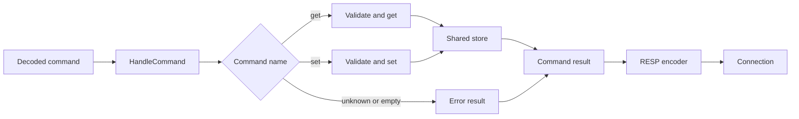

# GET and SET

The [traffic capture](redis-traffic.md#observed-requests-and-replies) shows actual `SET` and `GET` requests and their replies from Redis.

## Handling a command

The [decoder](decode.md) turns a RESP request into a slice of strings, for example, `get greeting` becomes `[]string{"get", "greeting"}`. The command handler interprets this slice and uses the shared [store](store.md) that the server provides. It doesn't write to the connection, but returns a result to the server which will give it to the RESP encoder to turn the result into reply bytes.



1. The server creates one store and one handler and shares them with the connection goroutines.
2. `HandleCommand` checks for an empty slice, then selects `get` or `set` by command name.
3. The selected method checks the argument count before accessing the slice or the store.
4. `get` reads the value and whether it exists; `set` stores the value. The handler returns the corresponding result.
5. The server passes the result to the [encoder](encode.md), then writes the encoded bytes to the connection.

## Command results

`Result` contains a `Kind` and a string `Value`. The kind distinguishes outcomes that cannot be represented by a string alone:

| Outcome | Result kind | Value |
| --- | --- | --- |
| Successful `SET` | `ReplySimpleString` | `OK` |
| `GET` finds a key | `ReplyBulkString` | Stored value, including an empty string |
| `GET` misses a key | `ReplyNoneBulkString` | Empty string; the kind marks the missing key |
| Empty, unknown, or invalid command | `ReplyError` | Error message |

## Shared rules

- Treat keys as case-sensitive: `name` and `Name` are different keys.
- Accept empty and binary keys/values through bulk-string encoding.
- Validate argument counts before reading or changing the store.
- Return a simple error for unknown commands or unsupported arguments.
- Keep one shared store across connections, not one store per client.

## SET

Reference: [official SET documentation](https://redis.io/docs/latest/commands/set/).

```text
SET key value
```

Initial behavior:

- Requires exactly three array elements: command, key, and value.
- Creates the key if absent; replaces its value if present.
- Returns `+OK\r\n` after the value has been stored.
- An empty value is valid.

Real Redis supports additional options such as `NX`, `XX`, and `EX`. This project's initial subset does not. Reject extra arguments instead of pretending those options worked.

## GET

Reference: [official GET documentation](https://redis.io/docs/latest/commands/get/).

```text
GET key
```

Initial behavior:

- Requires exactly two array elements: command and key.
- Returns the current value as a bulk string when the key exists.
- Returns `$-1\r\n` when the key is missing.
- Returns `$0\r\n\r\n` when the key exists with an empty value.

In real Redis, `GET` returns a wrong-type error for a key holding a non-string value. That case is not reachable in this string-only subset.

## Manual behavior checklist

Expected behavior to verify after implementation:

| Scenario | Expected result |
| --- | --- |
| `SET greeting hello`, then `GET greeting` | `OK`, then `hello` |
| Set an existing key to a new value | Subsequent `GET` returns the new value |
| `GET missing` | Null bulk string, not an error or empty string |
| `SET greeting ""`, then `GET greeting` | Existing empty bulk string |
| One client sets, another client gets | Both use the same store |
| Lowercase `get` / `set` | Same behavior as uppercase command names |
| Missing or extra arguments | Error; no store mutation |
| Unknown command | Error; no store mutation |
