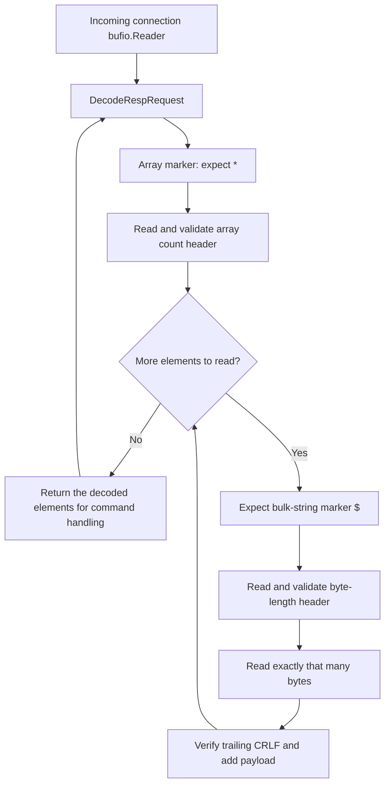

# Decoding a request

The bytes below encode `get test`:

```
[42 50 13 10 36 51 13 10 103 101 116 13 10 36 52 13 10 116 101 115 116 13 10]

*2\r\n
$3\r\n
get\r\n
$4\r\n
test\r\n
```

- `*2\r\n`: an array with two elements.
- `$3\r\nget\r\n`: a bulk string containing three bytes, `get`.
- `$4\r\ntest\r\n`: a bulk string containing four bytes, `test`.

The intended decoded result is the command and its arguments, for example `get` and `test`. The decoder should not need to know what `get` means; a command handler can validate and execute it later.

## Reading from the connection

TCP is a stream: one network read is not necessarily one request. A request can arrive in pieces, and multiple requests can arrive together. The server creates one `bufio.Reader` per connection and reuses it for every request, preserving any bytes buffered for the next request.

## Decoding steps

1. **Array marker:** expect `*`
2. **Array count n:** read the complete number header through `\n`, verify the preceding `\r`, and convert the digits to an integer. The count includes the command itself so `get test` has 2 elements, `set test "hello world"` has 3 elements
3. **Each array element:** repeat exactly n times:
   1. Expect the bulk-string marker `$`
   2. Read its byte-length header (same as Array count)
   3. Read exactly that many bytes
   4. Read and verify the following CRLF, then add the payload to the result
4. Return the decoded elements for command handling
