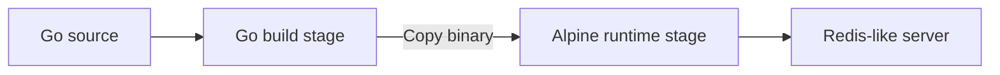

# Docker

## Building the container image

The Dockerfile uses a multi-stage build. The first stage uses a Go image to compile the server. The second stage starts from Alpine and copies only the compiled binary from the build stage. The final image does not need the Go compiler or the project source code to run the server.



In order to make the service available to Kubernetes and reference it in a [Deployment](kubernetes.md), an image has to be built from the directory containing the Dockerfile:

```bash
# Build the image and tag it redis-server:local
docker build -t redis-server:local .
```

`-t` sets the image name and tag; `.` supplies the current directory as the build context and the default Dockerfile location..

## Choosing a runtime image

The runtime image provides the environment in which the compiled server runs. Alpine is a small Linux distribution with a shell and package manager, which makes it convenient for learning and troubleshooting. It also contains more software to maintain than an empty runtime image.

Other options considered:

| Image | Characteristics |
| --- | --- |
| `scratch` | An empty starting point. The binary and any runtime files it needs must be supplied explicitly. |
| Distroless | Minimal runtime images, generally without a shell or package manager. [Google's distroless images](https://github.com/GoogleContainerTools/distroless) are a common choice. Different variants provide different runtime files. |
| Alpine | A small Linux image with a shell and package manager. |
| Debian slim | A larger base that can be convenient when the application needs additional libraries or familiar tools. |

### Go and CGO

The Dockerfile builds with `CGO_ENABLED=0`. For this server, that produces a binary that does not need C libraries at runtime. This avoids a mismatch between the Debian-based Go build image and Alpine, which uses a different C library. If a future dependency requires CGO, the build and runtime libraries will need to be considered together.

## Running as a non-root user

Application code should run as a non-root user to limit its permissions inside the container. Create a dedicated user where needed and select it with `USER` in the runtime stage. Some minimal images can instead use a numeric user ID or provide a non-root user already. 

| Runtime image | Non-root setup |
| --- | --- |
| Alpine | `RUN adduser -D redis-server`<br/> `USER redis-server` |
| Debian slim | `RUN useradd --no-create-home redis-server`<br/>`USER redis-server` |
| `scratch` | `USER 10001:10001` (use a numeric ID) |
| Distroless | Google's images mostly offer a `nonroot` variant. |

## Ports and local testing

The server listens on TCP port `6379`. `EXPOSE 6379` documents that port in the image, but it doesn't publish the port or create a network route. Port mapping is configured when the container runs, not in the Dockerfile.

```bash
docker run --rm -p 127.0.0.1:6379:6379 redis-server:local
```

The `-p` option maps port `6379` on the host's loopback interface to port `6379` in the container, keeping the published port local to the host.

Kubernetes configures access separately from the image. A Service can provide an endpoint inside the cluster, while `kubectl port-forward` can provide temporary access from the local machine for testing; see the [Kubernetes deployment notes](kubernetes.md).
