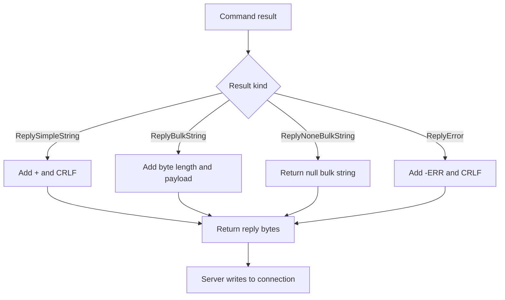

# Encoding a response

The command handler returns a `Result` containing a kind and a value. The RESP encoder converts that result into bytes, which the connection handler writes to the client. The [command notes](commands.md#command-results) describe the results, the [RESP notes](resp.md) describe their wire format.

## Encoding steps

| Result | Example value | Encoded reply |
| --- | --- | --- |
| `ReplySimpleString` | `OK` | `+OK\r\n` |
| `ReplyBulkString` | `hello` | `$5\r\nhello\r\n` |
| `ReplyBulkString` | empty string | `$0\r\n\r\n` |
| `ReplyNoneBulkString` | — | `$-1\r\n` |
| `ReplyError` | `unknown command CONFIG` | `-ERR unknown command CONFIG\r\n` |

For bulk strings, `len(value)` counts bytes, not Unicode characters. Payloads may contain CRLF or arbitrary bytes: the byte length determines where the payload ends. A missing key has its own result kind, so it is not confused with an empty value.

Simple strings and errors are terminated by CRLF and must not contain CR or LF in their text. The encoder escapes these characters in error messages, which can include client-provided command names, and rejects simple strings containing them. An unsupported result kind also returns a Go error. The connection handler closes the connection if encoding fails.
