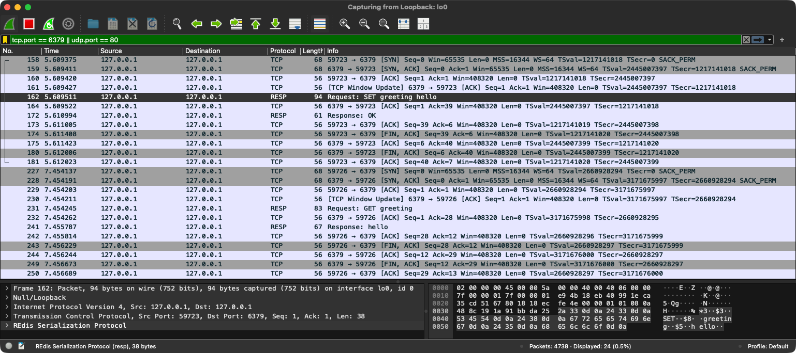

# Inspecting Redis Traffic

To see what `redis-cli` sends to Redis and what the server sends back, I captured local traffic with `tcpdump` and Wireshark. The requests use the types described in the [RESP notes](resp.md).

## Capture with tcpdump

```bash
# Capture local Redis traffic, including complete packet payloads.
sudo tcpdump -i lo0 -nn -s 0 -A 'tcp port 6379'
```

Options:
- `lo0`: the macOS loopback interface.
- `-nn`: show numeric addresses and ports.
- `-s 0`: capture complete packets.
- `-A`: display packet bytes as text, including IP/TCP headers.

## Observed requests and replies

The annotated examples below show the RESP parts on separate lines. Each line ends with CRLF (`\r\n`), which is not visible in this view.

```text
> SET greeting hello

# Received as a RESP array:
*3  <-------- Array of 3 elements
$3  <-------- Next bulk string has length 3 bytes
SET <-------- SET command as string
$8  <-------- Next bulk string has length 8 bytes
greeting <--- Key to set
$5  <-------- Next bulk string has length 5 bytes
hello <------ String value to be assigned to the key

# Server reply (simple string):
+OK

> GET greeting

# Received as a RESP array:
*2  <-------- Array of 2 elements
$3  <-------- Next bulk string has length 3 bytes
GET <-------- GET command as string
$8  <-------- Next bulk string has length 8 bytes
greeting <--- Key to get

# Server reply (bulk string):
$5
hello
```

**Finding:** commands are sent as [arrays of bulk strings](resp.md#arrays), not as a single bulk string. The replies depend on the [command](commands.md).

## Full tcpdump output

The capture also contains TCP connection setup, acknowledgments, and connection teardown. Packets marked `length 0` carry no TCP payload. The extra characters in the ASCII view include IP/TCP header bytes, not extra RESP fields.

```text
> sudo tcpdump -i lo0 -nn -s 0 -A 'tcp port 6379'
tcpdump: verbose output suppressed, use -v[v]... for full protocol decode
listening on lo0, link-type NULL (BSD loopback), snapshot length 524288 bytes
15:46:12.453801 IP 127.0.0.1.58827 > 127.0.0.1.6379: Flags [S], seq 3499587660, win 65535, options [mss 16344,nop,wscale 6,nop,nop,TS val 98254526 ecr 0,sackOK,eol], length 0
E..@..@.@.................xL.........4....?........
..>.........
15:46:12.453842 IP 127.0.0.1.6379 > 127.0.0.1.58827: Flags [S.], seq 2812274947, ack 3499587661, win 65535, options [mss 16344,nop,wscale 6,nop,nop,TS val 1175749634 ecr 98254526,sackOK,eol], length 0
E..@..@.@.....................xM.....4....?........
F.....>.....
15:46:12.453852 IP 127.0.0.1.58827 > 127.0.0.1.6379: Flags [.], ack 1, win 6380, options [nop,nop,TS val 98254526 ecr 1175749634], length 0
E..4..@.@.................xM.........(.....
..>.F...
15:46:12.453860 IP 127.0.0.1.6379 > 127.0.0.1.58827: Flags [.], ack 1, win 6380, options [nop,nop,TS val 1175749634 ecr 98254526], length 0
E..4..@.@.....................xM.....(.....
F.....>.
15:46:12.453948 IP 127.0.0.1.58827 > 127.0.0.1.6379: Flags [P.], seq 1:39, ack 1, win 6380, options [nop,nop,TS val 98254526 ecr 1175749634], length 38: RESP "SET" "greeting" "hello"
E..Z..@.@.................xM.........N.....
..>.F...*3
$3
SET
$8
greeting
$5
hello

15:46:12.453962 IP 127.0.0.1.6379 > 127.0.0.1.58827: Flags [.], ack 39, win 6380, options [nop,nop,TS val 1175749634 ecr 98254526], length 0
E..4..@.@.....................xs.....(.....
F.....>.
15:46:12.454954 IP 127.0.0.1.6379 > 127.0.0.1.58827: Flags [P.], seq 1:6, ack 39, win 6380, options [nop,nop,TS val 1175749635 ecr 98254526], length 5: RESP "OK"
E..9..@.@.....................xs.....-.....
F.....>.+OK

15:46:12.454965 IP 127.0.0.1.58827 > 127.0.0.1.6379: Flags [.], ack 6, win 6380, options [nop,nop,TS val 98254527 ecr 1175749635], length 0
E..4..@.@.................xs... .....(.....
..>.F...
15:46:12.455334 IP 127.0.0.1.58827 > 127.0.0.1.6379: Flags [F.], seq 39, ack 6, win 6380, options [nop,nop,TS val 98254527 ecr 1175749635], length 0
E..4..@.@.................xs... .....(.....
..>.F...
15:46:12.455351 IP 127.0.0.1.6379 > 127.0.0.1.58827: Flags [.], ack 40, win 6380, options [nop,nop,TS val 1175749635 ecr 98254527], length 0
E..4..@.@..................     ..xt.....(.....
F.....>.
15:46:12.455958 IP 127.0.0.1.6379 > 127.0.0.1.58827: Flags [F.], seq 6, ack 40, win 6380, options [nop,nop,TS val 1175749636 ecr 98254527], length 0
E..4..@.@..................     ..xt.....(.....
F.....>.
15:46:12.455978 IP 127.0.0.1.58827 > 127.0.0.1.6379: Flags [.], ack 7, win 6380, options [nop,nop,TS val 98254528 ecr 1175749636], length 0
E..4..@.@.................xt...
.....(.....
                                                                                  ..>.F...
15:53:14.303606 IP 127.0.0.1.59387 > 127.0.0.1.6379: Flags [S], seq 488716203, win 65535, options [mss 16344,nop,wscale 6,nop,nop,TS val 4108485813 ecr 0,sackOK,eol], length 0
E..@..@.@................!7..........4....?........                                          ............
15:53:14.303685 IP 127.0.0.1.6379 > 127.0.0.1.59387: Flags [S.], seq 3451514986, ack 488716204, win 65535, options [mss 16344,nop,wscale 6,nop,nop,TS val 3499653107 ecr 4108485813,sackOK,eol], length 0
E..@..@.@..................j.!7......4....?........                                          ..w.........
15:53:14.303704 IP 127.0.0.1.59387 > 127.0.0.1.6379: Flags [.], ack 1, win 6380, options [nop,nop,TS val 4108485813 ecr 3499653107], length 0
E..4..@.@................!7....k.....(.....                                                  ......w.
15:53:14.303717 IP 127.0.0.1.6379 > 127.0.0.1.59387: Flags [.], ack 1, win 6380, options [nop,nop,TS val 3499653107 ecr 4108485813], length 0
E..4..@.@..................k.!7......(.....                                                  ..w.....
15:53:14.303770 IP 127.0.0.1.59387 > 127.0.0.1.6379: Flags [P.], seq 1:28, ack 1, win 6380, options [nop,nop,TS val 4108485813 ecr 3499653107], length 27: RESP "GET" "greeting"
E..O..@.@................!7....k.....C.....
......w.*2
$3
GET
$8
greeting

15:53:14.303791 IP 127.0.0.1.6379 > 127.0.0.1.59387: Flags [.], ack 28, win 6380, options [nop,nop,TS val 3499653107 ecr 4108485813], length 0
E..4..@.@..................k.!7......(.....
..w.....
15:53:14.305333 IP 127.0.0.1.6379 > 127.0.0.1.59387: Flags [P.], seq 1:12, ack 28, win 6380, options [nop,nop,TS val 3499653109 ecr 4108485813], length 11: RESP "hello"
E..?..@.@..................k.!7......3.....
..w.....$5
hello
15:53:14.305343 IP 127.0.0.1.59387 > 127.0.0.1.6379: Flags [.], ack 12, win 6380, options [nop,nop,TS val 4108485815 ecr 3499653109], length 0
E..4..@.@................!7....v.....(.....
......w.
15:53:14.305775 IP 127.0.0.1.59387 > 127.0.0.1.6379: Flags [F.], seq 28, ack 12, win 6380, options [nop,nop,TS val 4108485815 ecr 3499653109], length 0
E..4..@.@................!7....v.....(.....
......w.
15:53:14.305789 IP 127.0.0.1.6379 > 127.0.0.1.59387: Flags [.], ack 29, win 6380, options [nop,nop,TS val 3499653109 ecr 4108485815], length 0
E..4..@.@..................v.!7......(.....
..w.....
15:53:14.306530 IP 127.0.0.1.6379 > 127.0.0.1.59387: Flags [F.], seq 12, ack 29, win 6380, options [nop,nop,TS val 3499653110 ecr 4108485815], length 0
E..4..@.@..................v.!7......(.....
..w.....
15:53:14.306549 IP 127.0.0.1.59387 > 127.0.0.1.6379: Flags [.], ack 13, win 6380, options [nop,nop,TS val 4108485816 ecr 3499653110], length 0
E..4..@.@................!7....w.....(.....
......w.
```

## Wireshark view

Wireshark separates the loopback, IP, TCP, and RESP layers, making it easier to distinguish the request from the surrounding network traffic.



The selected `SET greeting hello` frame contains 94 captured bytes, of which 38 are the RESP payload. Its full hexadecimal view is:

```text
0000   02 00 00 00 45 00 00 5a 00 00 40 00 40 06 00 00
0010   7f 00 00 01 7f 00 00 01 e9 4b 18 eb 40 99 1e ca
0020   35 cd 51 67 80 18 18 ec fe 4e 00 00 01 01 08 0a
0030   48 8c 19 1a 91 bb da 25 2a 33 0d 0a 24 33 0d 0a
0040   53 45 54 0d 0a 24 38 0d 0a 67 72 65 65 74 69 6e
0050   67 0d 0a 24 35 0d 0a 68 65 6c 6c 6f 0d 0a
```

The RESP payload starts at offset `0x38` with `2a 33 0d 0a` (`*3\r\n`). The preceding bytes belong to the capture's loopback header and the IP/TCP headers. `0d 0a` is CRLF.

## Strings, bytes, and encoding

Can I send strings to the TCP server directly, or do I need to translate them into bytes first?

- TCP transports bytes. A Go string already holds bytes; `io.WriteString` can write them to a connection, or `conn.Write` accepts a `[]byte`.
- RESP encoding is a separate step: sending just `SET greeting hello` is not the same as sending the array-of-bulk-strings format captured here.
- The server needs to **decode requests** and **encode replies**. When using `redis-cli`, the client already encodes the requests.
- If a value is set in quotes, as in `SET greeting "hello"`, the quotes are not part of the value sent in the request. For example, `SET greeting ""` sends an empty bulk string.

Possible first piece of code to explore: RESP encode/decode functions. The [RESP notes](resp.md) describe the individual types.
