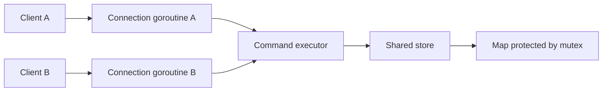

# In-memory store

The store holds string keys and values in memory. All client connections use the same store, so a value set by one client can be retrieved by another. Data belongs to one server process and is lost when that process stops.

For example, `SET greeting hello` stores `hello` under `greeting`. A later `GET greeting` returns `hello`. The store only needs to manage keys and values, argument validation and responses is handled by the command handler.

## Storing and retrieving values

A map associates each key with a value. `Set` creates a key or replaces its existing value. `Get` returns the value and whether the key exists:

```go
s.Set("greeting", "hello")
value, found := s.Get("greeting") // "hello", true
```

The existence result distinguishes a missing key from an existing key with an empty value. Keys and values can be empty or contain arbitrary bytes; keys are case-sensitive.

## Shared access

The server starts a goroutine for each connection. A connection handles its requests sequentially, but requests from different connections can run at the same time. The connection handlers share the store, so their goroutines can access the map concurrently.



Go maps need synchronization when reads and writes, or multiple writes, happen concurrently. A mutex protects each map operation. The lock is held only while accessing the map, not while reading from or writing to the network.

## Test-driven development

While the rest of the project omits tests, I decided to follow a test-driven approach for the data store: each step starts with a test for an observable behavior, followed by the implementation needed to make it pass.

| Planned test | Expected behavior |
| --- | --- |
| Set and get a value | The stored value is returned and the key is found |
| Get a missing key | The key is reported as missing |
| Set an empty value | The key is found and its value is empty |
| Replace a value | Getting the key returns the new value |
| Concurrent access to different keys | Each goroutine can store and retrieve its own value in the shared store |
| Concurrent reads and writes to one key | Reads return complete stored values without assuming which writer finishes last |

The race detector checks for data races in the executions exercised by the tests:

```bash
go test -race ./store
go test -race -count=20 ./store
```
