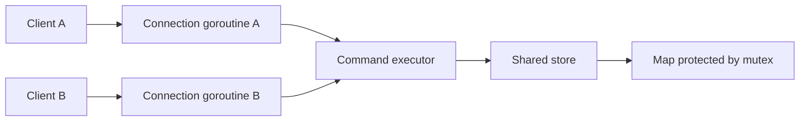
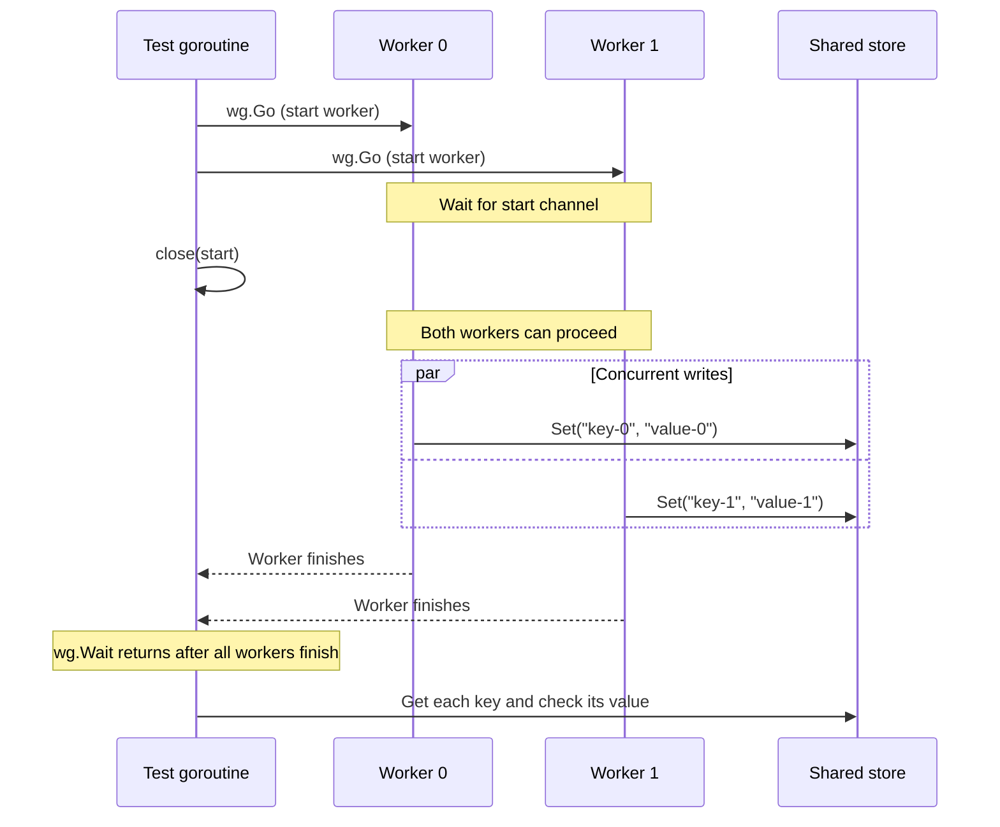
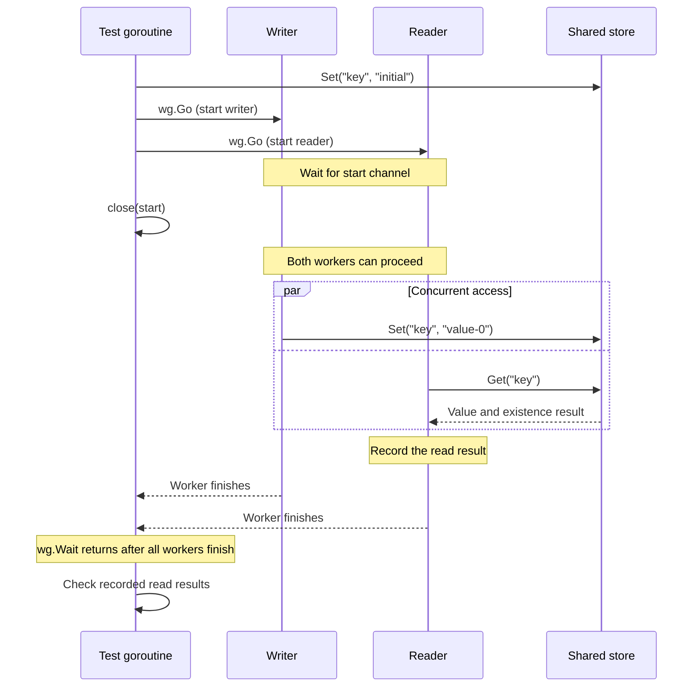

# In-memory store

The store holds string keys and values in memory. All client connections use the same store, so a value set by one client can be retrieved by another. Data belongs to one server process and is lost when that process stops.

For example, `SET greeting hello` stores `hello` under `greeting`. A later `GET greeting` returns `hello`. The store only needs to manage keys and values, argument validation and responses is handled by the command handler.

## Storing and retrieving values

A map associates each key with a value. `Set` creates a key or replaces its existing value. `Get` returns the value and whether the key exists:

```go
s.Set("greeting", "hello")
value, found := s.Get("greeting") // "hello", true
```

The existence result distinguishes a missing key from an existing key with an empty value. Keys and values can be empty or contain arbitrary bytes; keys are case-sensitive.

## Shared access

The server starts a goroutine for each connection. A connection handles its requests sequentially, but requests from different connections can run at the same time. The connection handlers share the store, so their goroutines can access the map concurrently.



Go maps need synchronization when reads and writes, or multiple writes, happen concurrently. A mutex protects each map operation. The lock is held only while accessing the map, not while reading from or writing to the network.

## Test-driven development

While the rest of the project omits tests, I decided to follow a test-driven approach for the data store: each step starts with a test for an observable behavior, followed by the implementation needed to make it pass.

| Planned test | Expected behavior |
| --- | --- |
| Set and get a value | The stored value is returned and the key is found |
| Get a missing key | The key is reported as missing |
| Set an empty value | The key is found and its value is empty |
| Replace a value | Getting the key returns the new value |
| Concurrent access to different keys | Each goroutine can store and retrieve its own value in the shared store |
| Concurrent reads and writes to one key | Reads return complete stored values without assuming which writer finishes last |

### Concurrent writes to different keys

The concurrent test creates one store and starts 20 workers. Each worker writes its own key and value to that shared store. 



- `wg.Go` starts a goroutine and tracks its completion. `wg.Wait()` waits until all tracked workers have returned, so the test does not check results or finish early.
- Each worker waits on `<-start`. Closing the channel releases all waiting workers, giving their writes an opportunity to overlap. It does not guarantee that they run simultaneously or in a particular order.
- Each iteration has its own `i`, so each worker builds a different key and value. Different keys avoid a winner-dependent final value, but the workers still share the same map and concurrent writes need synchronization.
- The `Get` checks happen **after** `wg.Wait()`. This checks the result of concurrent writes.

### Concurrent reads and writes to one key

The same-key test starts with a known value in the store. Writer goroutines replace it with values from a known set, while reader goroutines retrieve the same key. A start channel and wait group coordinate the workers as in the different-key test.



- The initial `Set` happens before the workers start, so every read should find the key, even if it runs before any writer.
- After `close(start)`, readers and writers can access the same key without a guaranteed order. A read may return the initial value or any complete value written by a worker.
- Each reader records its results for the test goroutine to check after `wg.Wait()`. The result collection must also be safe for concurrent use, for example by giving each reader its own result slot.
- The final value can be any value written; the test cannot assume which writer finishes last. The race detector complements these checks by reporting unsynchronized access even when values happen to look correct.

### Race detector

The race detector checks for data races in the executions exercised by the tests:

```bash
go test -race ./store
go test -race -count=20 ./store
```

The second command repeats the tests 20 times, giving the scheduler more opportunities to exercise different interleavings. A passing run does not prove that all possible schedules are race-free. An unprotected map can also cause a runtime crash during concurrent access; checking the final values alone is not enough to establish that the store is safe.
