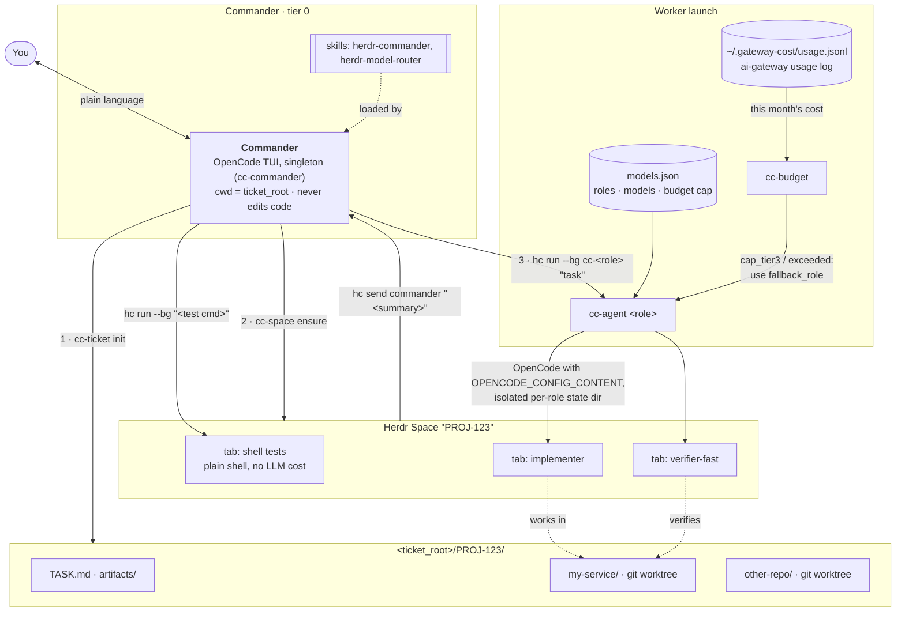

# HerdrCommander

A small orchestration framework for Herdr and [OpenCode](https://opencode.ai): one cheap **Commander** agent that talks to you, and any number of scoped **worker** agents that each live in their own Herdr Space and git worktree. It is plain Python (stdlib only) plus a few markdown files; there is no daemon of its own.

- **Commander**: decomposes your request, provisions a ticket folder with git worktrees, finds or creates the matching Herdr Space, picks a model tier per job, spawns/steers workers with `hc` and reports verified results. It never blocks on workers: it dispatches, ends its turn and reacts to each report as it arrives, so you can give it new tasks at any time (you are the CEO, it is the manager). It never edits code itself.
- **Workers**: OpenCode sessions pinned to a role (`implementer`, `architect`, `verifier-deep`, ...) with a model, reasoning variant and permission set taken from one config file.
- **Guardrails**: roles are cheap-by-default, tests run in a plain shell first, and an optional monthly budget downgrades the most expensive role automatically.

It works with **any OpenCode provider**. The [ai-gateway plugin](../ai-gateway) is optional and only needed for the cost log that powers the budget guardrail (see [Budget guardrail](#budget-guardrail)).

## Architecture



Pieces:

| Piece | What it is |
|---|---|
| `cc-agent` | Launches OpenCode as a given role (model, variant, permissions, initial prompt). |
| `cc-commander` | Ensures the singleton Commander terminal exists (`--restart`, `--focus`). |
| `cc-ticket` | Creates `<ticket_root>/<TICKET-ID>/` with `TASK.md`, `artifacts/` and one git worktree per repo. |
| `cc-space` | Finds or creates the Herdr Space for a ticket, idempotently. |
| `cc-budget` | Month-to-date spend vs. the cap, from the optional cost log. |
| `templates/cc-*.md` | `hc` templates, so `hc run cc-implementer "task"` starts the right role. |
| `skills/` | Three agent skills that teach the Commander and the workers the protocol. |

## Requirements

- Python >= 3.9 (stdlib only), git >= 2.31
- `hc` (herdr-core, tested with 0.1.21) and `herdr-app`
- `opencode` (tested with 2.3.x) with at least one authenticated provider
- Optional: the `ai-gateway` plugin, for cost tracking
- macOS or Linux. The installer is bash 3.2 compatible.

`install.sh` checks these and prints install hints; it never installs them.

## Install / uninstall

```sh
./install.sh --dry-run     # shows exactly what would change
./install.sh               # install or update
./install.sh --uninstall   # remove what the installer put there
```

What it does:

- Copies `bin/*` to `$PREFIX/bin` (default `~/.local/bin`) and warns if that is not on your `PATH`.
- Renders `templates/*.md` into `~/.config/herdr-core/templates/`, replacing `__CC_AGENT__` with the real path of `cc-agent`.
- Installs the skills to `~/.agents/skills/<name>/` and symlinks them into `~/.config/opencode/skills/` and `~/.claude/skills/`, but only if those folders already exist.
- Creates `~/.config/command-center/models.json` from `config/models.example.json` **only if it is missing**. An existing config is never touched.
- Any existing file that differs is summarised in one line (`+N/-M lines`) and copied to `~/.setup_backup/<timestamp>/` before it is replaced.

After a first install, edit `~/.config/command-center/models.json` and replace each `<provider>/<model>` placeholder with a model id from `opencode models`. `cc-agent` refuses to start while placeholders remain.

Environment overrides for the installer: `PREFIX`, `CC_CONFIG`, `HC_TEMPLATES_DIR`, `SKILLS_DIR`. Uninstall keeps your `models.json` and `~/.local/state/command-center/`.

## Daily usage

Start (or find) the Commander and bring it into view:

```sh
cc-commander --focus      # prints JSON: {"status": "existing"|"created", "address": "t12", ...}
cc-commander --restart    # replace it with a fresh one (workers keep running)
```

The Commander is an OpenCode TUI started in `workspace.ticket_root`. Talk to it in plain language ("fix PROJ-123 in my-service, add a regression test"). A typical ticket flow, run by the Commander for you:

```sh
cc-ticket init PROJ-123 --repo my-service --title "Fix login redirect"
cc-space ensure PROJ-123 --folder ~/src/PROJ-123          # reuse or create the Space
hc run --bg --keep --outlive-parent --name proj-123-impl \
  --cwd ~/src/PROJ-123/my-service \
  --label herdr.space=<space id> --label cc.role=implementer \
  --label cc.model="$(cc-agent implementer --model-label)" --label cc.ticket=PROJ-123 \
  cc-implementer "Ticket PROJ-123. Scope: ... Report back with: hc send commander \"<summary>\""
# then the Commander ends its turn; the report arrives later as <hc from="...">...</hc>
hc ls --label cc.ticket=PROJ-123 --label cc.role=implementer --json   # find an existing worker
```

You can also use the pieces by hand:

```sh
cc-agent implementer --cwd ~/src/PROJ-123/my-service --prompt "Fix the flaky test"
cc-agent architect --dry-run            # resolved model, variant, permissions, env; runs nothing
cc-agent implementer --mini             # opencode's minimal interface (variant comes from the agent entry)
cc-agent implementer -- --session abc   # everything after -- goes to opencode untouched
```

`cc-ticket` details:

- `--repo` accepts a bare **name** (searched in `repo_search_roots`; a linked worktree hit resolves to its main checkout), a **path** (must contain `/` or start with `~` or `.`), or a **git URL** (cloned into `repo_cache`). A bare name is never interpreted relative to the current directory.
- It runs `git fetch` (failure is only a warning) and branches from `origin/HEAD`, falling back to `HEAD`. `--base` overrides. If `origin/<branch>` already exists the new local branch tracks it; otherwise it is created without upstream tracking.
- Re-running is idempotent. An existing worktree is verified to be a real worktree root and its actual branch is reported; a mismatch is flagged in `warnings` and the worktree entry. A branch that is already checked out elsewhere produces a clear error naming the path. Newly added worktrees are appended to an existing `TASK.md`.
- Output is JSON; the exit code is 1 when `errors` is non-empty.

`cc-space` statuses: `existing`, `created` (always with a `space` id), `not_found`, and `name_match_folder_differs` (a Space with that name exists for a different folder, nothing is created, exit code 3). `--folder` must be an existing directory; folders are compared by identity (`samefile`), not by lowercased strings.

## Configuration reference

File: `~/.config/command-center/models.json` (override the path with the `CC_CONFIG` environment variable). All path values accept `~` and `$HOME`/`$VARS`. JSON has no comments; unknown keys (such as `_comment`) are ignored. Every key is optional unless stated.

| Key | Default | Meaning |
|---|---|---|
| `version` | `1` | Informational. |
| `budget.monthly_cap_usd` | none | Monthly cap in USD. Without it, budget status is `unknown`. |
| `budget.soft_warn_pct` | `75` | Status becomes `warn` at this percent of the cap. |
| `budget.auto_cap_tier3_pct` | `85` | Status becomes `cap_tier3` here; roles with `fallback_role` are downgraded. |
| `budget.usage_file` | `~/.gateway-cost/usage.jsonl` | JSONL cost log. If missing, status is `unknown` and nothing is ever downgraded. |
| `workspace.ticket_root` | `~/src` | Parent of the `<TICKET-ID>/` folders; also the Commander's working directory (created if missing). |
| `workspace.repo_cache` | `<ticket_root>/_repos` | Where URL repos are cloned. |
| `workspace.repo_search_roots` | `[repo_cache, ticket_root, ~/dev]` | Folders searched for a bare `--repo name`, in order. |
| `workspace.default_branch_prefix` | `feat` | Default branch is `<prefix>/<TICKET-ID>` (empty prefix: just the ticket id). |
| `workspace.ticket_id_pattern` | none (permissive) | Optional regex; the ticket id must fully match it, e.g. `[A-Z]+-\\d+`. Without it any slug is accepted (characters outside `A-Za-z0-9._-` become `-`; `.`, `..`, `_repos` are rejected). |
| `tools.hc`, `tools.herdr_app`, `tools.opencode` | auto | Explicit binary paths. Otherwise resolved with `PATH`, then the well-known locations `~/.local/bin/hc`, `~/.local/bin/herdr-app`, `~/.opencode/bin/opencode`. |
| `roles.<name>` | required | One entry per role, see below. |

Role keys:

| Key | Meaning |
|---|---|
| `model` | `provider/model` id as in `opencode models`. A `#variant` suffix is accepted. **Required.** |
| `variant` | Reasoning variant (`low`, `medium`, `high`, ... provider dependent). Omit if the model has none. |
| `tier` | Informational (0-3), used by the skills' routing policy. |
| `mode` | `primary` or `subagent` (OpenCode). `cc-agent` always launches the chosen role as primary. |
| `short` | Informational short name. |
| `auto` | Auto-approve permissions (default `true`); `--no-auto` / `--auto` override per launch. |
| `read_only` | Deny edit/write and allow only read-only shell commands (see Security). |
| `fallback_role` | Role to use instead when the budget status is `cap_tier3` or `exceeded` (bypass: `--force` or `--model`). |
| `description` | Shown to OpenCode and in `@mentions`. |
| `prompt` | System prompt for the role. |

Environment: `CC_CONFIG` (config path), `CC_STATE_DIR` (default `~/.local/state/command-center`: locks and per-role OpenCode state).

`cc-agent` builds an OpenCode `agent{}` map from the roles on every launch and passes it in `OPENCODE_CONFIG_CONTENT`, so **you do not need to duplicate the roles in `opencode.json`**. Each role gets its own `XDG_STATE_HOME`, so a worker never inherits another session's model/variant picks, and `HC_SOCKET` is pinned so `hc` inside the agent talks to the right core.

## Roles and tiers

The example config ships nine roles. Tiers are about cost, not importance.

| Role | Tier | Mode | Purpose |
|---|---:|---|---|
| `commander` | 0/1 | primary | Dispatcher; cheap and concise. |
| `explore` | 1 | subagent, read-only | File/symbol search and repo mapping. |
| `verifier-fast` | 1 | primary | Test/lint triage and log summaries. |
| `implementer` | 2 | primary | Default coding agent. |
| `reviewer` | 2 | subagent, read-only | Diff review before reporting done. |
| `implementer-pro` | 2 | primary | Complex multi-file refactors and subtle bugs. |
| `architect` | 3 | primary | Specs, plans, root-cause diagnosis. |
| `verifier-deep` | 3 | primary | Security and integration verification. |
| `escalation` | 3 | primary | Last resort; `fallback_role: architect` under budget pressure. |

Each role except `explore` and `reviewer` has an `hc` template `cc-<role>` (installed by `install.sh`), so `hc run cc-<role> "task"` starts it with a task prompt and lets `hc` track task delivery. Rule of thumb: run tests in a plain shell (`hc run --bg ... "<cmd>"`, no LLM cost) before involving any model.

## Budget guardrail

`cc-budget` sums the current month's rows of the ai-gateway usage log (`budget.usage_file`) and prints either JSON or, with `--short`, one line: `$89.88/$250 (36%) proj $150 [ok]` (spent/cap, share used, projected month-end spend, status).

| Status | Meaning |
|---|---|
| `ok` | Below `soft_warn_pct`. |
| `warn` | At or above `soft_warn_pct`: prefer cheaper tiers, fewer parallel workers. |
| `cap_tier3` | At or above `auto_cap_tier3_pct`: `cc-agent escalation` is downgraded to its `fallback_role`. |
| `exceeded` | At or above 100%: same downgrade. |
| `unknown` | No cap configured (the spend is still reported), or the usage log is missing/unreadable. **Never downgrades anything.** |

The log is the **optional** `ai-gateway` plugin's usage log (sibling folder `../ai-gateway` in this repository), the single source of truth for usage: OpenCode's gateway steps, Claude Code's calls (`billing: usage`) and any other tool that logs there. `cc-budget` counts it exactly like the usage dashboard's **Month** range: every row and billing mode, the local calendar month, each `event_id` once, with the cost each row carries (it computes no prices itself). The JSON output also has the split `by_billing`, `by_tool` and `top_models`. Without it, or with a different provider, the framework works the same and the budget simply stays `unknown`. You can also point `usage_file` at any JSONL with rows like `{"ts": "2026-05-01T10:00:00Z", "cost": 0.12, "tool": "opencode", "provider_id": "...", "model_id": "..."}`.

## The skills

Installed to `~/.agents/skills/` (and symlinked for OpenCode and Claude Code):

- **`herdr-commander`**: the Commander's protocol: delegate, one Space per ticket, idempotent provisioning, naming rules for `hc run --name`, labels (`cc.role`, `cc.model`, `cc.ticket`, `herdr.space`), finding existing workers, event-driven reports (no blocking waits), cleanup.
- **`herdr-model-router`**: tier-based routing policy (shell first, cheap for triage, strong only when needed) and how to read `cc-budget`. It is a *skill*: agents load it by name, it is not a command.
- **`herdr-worker`**: the contract for workers: stay in the worktree, use `@explore`/`@reviewer`, write verbose output to `artifacts/`, report back with `hc send`.

## Troubleshooting

- **`cc-agent`: role still has a placeholder model**: edit `models.json` and use real ids from `opencode models`.
- **`command not found: cc-agent`**: `~/.local/bin` is not on `PATH`; the installer prints the line to add.
- **Commander runs but `hc` inside it cannot connect**: `HC_SOCKET` is derived from `HC_TERMINAL_SOCKET` or `$XDG_STATE_HOME/herdr-core/<session>/<session>.sock`. Launch roles through `cc-agent`, not `opencode` directly, so it is pinned.
- **`cc-space` returns `name_match_folder_differs`**: a Space with that name already exists for another folder. Reuse it or choose a new name.
- **`cc-commander --focus` reports `"focused": false`**: the Commander is an unlabeled hidden terminal; focusing needs a running Herdr window (`herdr-app status`).
- **Worker name rejected by `hc run --name`**: names are 1-32 chars of `a-z0-9-_`, lowercase, unique among live terminals.
- **Commander ignores you or a report for minutes**: it is stuck in `hc wait`. OpenCode queues anything typed into a working agent until its turn ends, and a person's typing does not wake `hc wait`. The Commander must not wait on workers (see the `herdr-commander` skill); if an old Commander still does, re-run `install.sh` and `cc-commander --restart`.
- **A report got glued onto text you were typing in the Commander**: `install.sh` sets `draft_wait = 0` in `~/.config/herdr-core/config.toml` so reports are delivered at once, even into a half-typed message. Raise it (seconds) if you prefer hc to hold reports while you type.
- **`cc-ticket`: branch already checked out**: a worktree (or the base checkout) already holds that branch; pick another `--branch` or remove the old worktree.
- **Budget shows `unknown`**: expected without a cost log or a cap. Set `budget.monthly_cap_usd` and install the ai-gateway plugin (or provide your own `usage_file`).
- **Stale base**: `cc-ticket` fetches before branching; if the fetch failed you get a warning and local refs are used.

## Security notes

- Workers run with **auto-approve permissions** by default (`"*": "allow"` in OpenCode, `--auto`). They can run any shell command and edit any file their user can. Use `--no-auto` or `"auto": false` on a role to get prompts, run in disposable worktrees (which `cc-ticket` already gives you), and keep secrets out of the ticket folders.
- `read_only` roles (`explore`, `reviewer`) deny edit/write and shell, except `git diff*`, `git log*`, `git show*`, `git status*`, `rg *`, `ls`. Flags that can execute programs or write files (`rg --pre`, `git ... --output`) are denied after the allows (OpenCode evaluates rules in order, the last match wins). This is a convenience guardrail, not a sandbox: a read-only role can still read anything the user can.
- The Commander is told never to edit code, but that is policy, not enforcement; it runs auto-approved like the others.
- Prompts and role definitions travel in the `OPENCODE_CONFIG_CONTENT` environment variable, visible to same-user processes.
- `install.sh` writes only the files listed above, never overwrites your config, and backs up anything it replaces. Review the scripts before installing; they are short.
