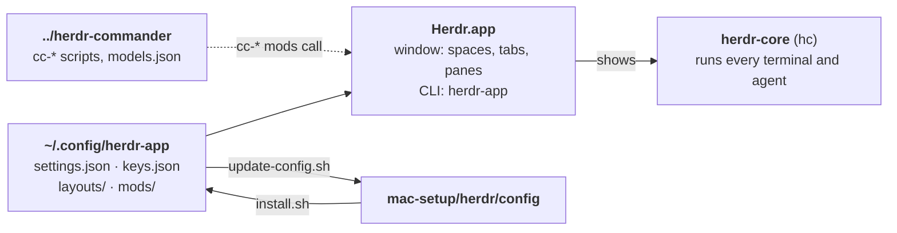

# Herdr desktop app setup [https://herdr.dev](https://herdr.dev)

[Herdr](https://github.com/herdrdev/herdr-app) is a desktop app for terminals and coding agents. The window arranges spaces, tabs and panes, and [herdr-core](https://github.com/herdrdev/herdr-core) (`hc`) runs the terminals, so they keep running when the window closes. Everything about the window is set by JSON files and JavaScript mods in `~/.config/herdr-app`. This folder keeps my copy of them.

> **App, not TUI.** The [herdr TUI](https://github.com/herdrdev/herdr) (`brew install herdr`, config in `~/.config/herdr`) is a separate program that runs inside a terminal. I switched to the desktop app, so `setup.sh` installs the app only (cask `herdr-app`) and nothing here touches the TUI. See [The herdr TUI](#the-herdr-tui-not-used) below.

## How it fits together



## What is in [config/](config/)

| Path | What it is |
|---|---|
| `settings.json` | dark appearance, sounds on, no ligatures, telemetry off |
| `keys.json` | key bindings: cmd-t/w tabs, cmd-d split, cmd-alt-arrows move between panes, cmd-shift-l switch layout, and in the Command Center layout cmd-shift-j (Commander) and cmd-shift-m (panel) |
| `layouts/command-center.json` | the **Command Center** layout: the workspace layout plus the Commander terminal, Mission Control (tasks), the agents list, and the GitHub and Usage panels |
| `layouts/github-workspace.json` | the workspace layout with the extra GitHub and Usage panels |
| `layouts/*.svg` | the previews the layout picker shows |
| `mods/cc-*` | Command Center mods: `cc-commander` (the Commander terminal), `cc-agents` (worker agents with role and model badges), `cc-tasks` (Mission Control: tickets and budget), `cc-status` (status bar with the budget), `cc-pane` (pane header), `cc-tabs` (tab bar with the Commander, Tasks, GitHub and Usage buttons) |
| `mods/my-github` | your open PRs and review requests (`gh search prs`), and local branches of the open repos |
| `mods/my-usage` | a compact copy of the AI gateway usage dashboard (spend, budget, top models) |
| `mods/my-workspace-tabs` | the tab bar of the GitHub workspace layout, a clone of Herdr's `tabs` mod |

Only files that are mine are kept. The mods, layouts, icons and themes that ship with Herdr are listed in `~/.config/herdr-app/installed.json` and are left alone, and so are the files Herdr writes itself: `view.json`, `window.json`, `shared.json`, `data/`, and the `gpui-kit.d.ts` and `jsconfig.json` it puts into every mod folder.

The `cc-*` mods and `my-usage` need other parts of this repo to show anything:

- `cc-*`: the [herdr-commander](../../herdr-commander/README.md) scripts (`cc-commander`, `cc-budget`, ...) in `~/.local/bin` and `~/.config/command-center/models.json`. Install them with `../../herdr-commander/install.sh`.
- `my-usage`: the [AI gateway](../../ai-gateway/README.md) usage log (`setup.sh` step `gateway`).
- `my-github`: a logged-in `gh` (step `github`).

## Install

On a new Mac, `./setup.sh` runs the `herdr` step: it installs the app with `brew install --cask herdr-app` (skipped when `Herdr.app` is already in `/Applications` or `~/Applications`), then runs [install.sh](install.sh). Launch Herdr once after that. On launch it creates `~/.config/herdr-app` and the `~/.local/bin/herdr-app` link. The cask links `herdr-app` into Homebrew's bin folder as well.

```bash
cd mac-setup/herdr
./install.sh                # or: ../setup.sh --only herdr
DRY_RUN=1 ./install.sh      # only report what would change
```

`install.sh` works like the rest of `setup.sh`:

- Missing files are copied.
- Files that match the repo print `unchanged`.
- A file that differs asks **Overwrite**, **Show diff** or **Skip**. The old file goes to `~/.setup_backup/<stamp>/` first.
- Files that only exist on the Mac stay where they are.

After that it runs `herdr-app check` on every mod. Switch to the layout with `cmd-shift-l`, or with `herdr-app do layout.switch command-center`.

Installing by hand works too. Use the official script (`curl -fsSL https://releases.herdr.dev/app/install.sh | sh`, which puts the app in `~/Applications` and also installs herdr-core if it is missing) or the [DMG](https://releases.herdr.dev/app/Herdr.dmg). Herdr updates itself in both cases.

## Keeping the repo current

`../update-config.sh` also pulls the Herdr files back into the repo. [user_files.py](user_files.py) decides which files are mine: `settings.json`, `keys.json`, and every layout and mod that is not in `installed.json`. When the Commander runs, the live layout holds a `commander-term` block whose terminal id changes on every restart. That block is removed on the way into the repo, and `cc-commander` adds it back. `install.sh` treats a live layout that only differs by that block as unchanged.

A new mod or layout you build in Herdr is picked up the next time you run `update-config.sh`.

